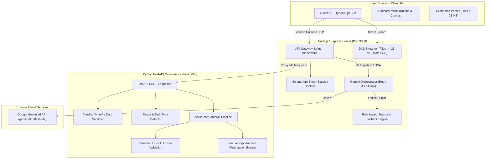
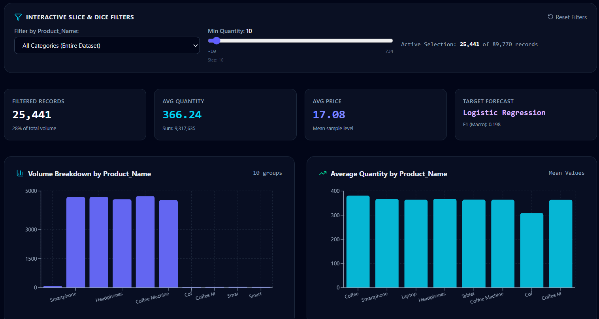
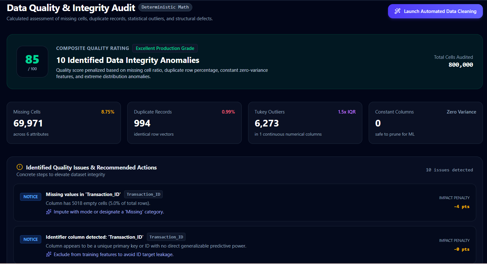
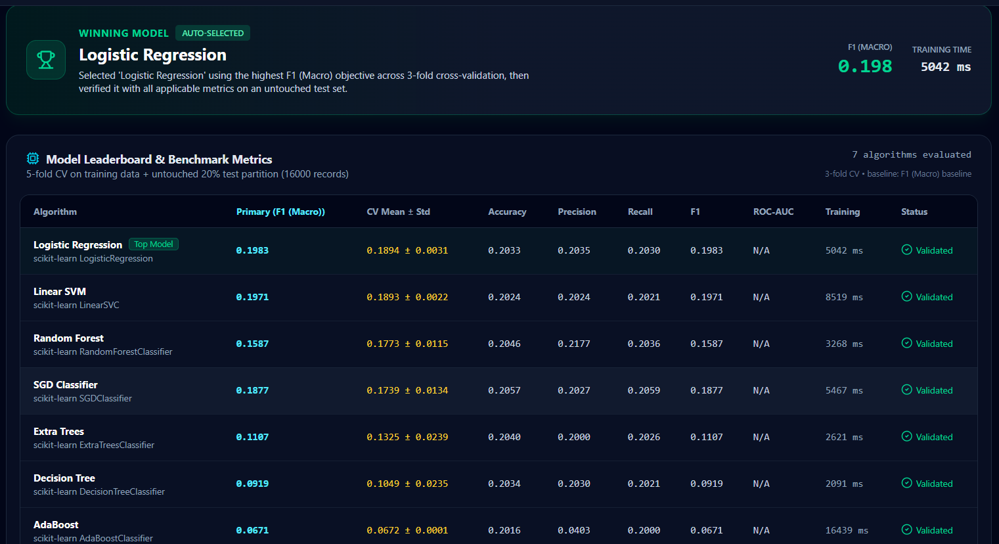
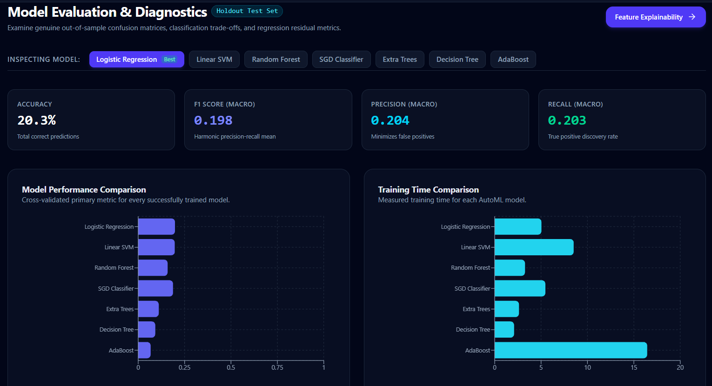
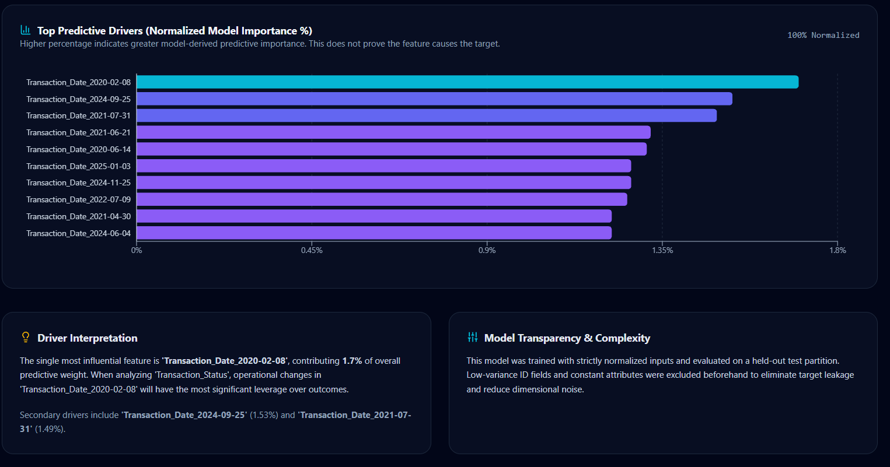
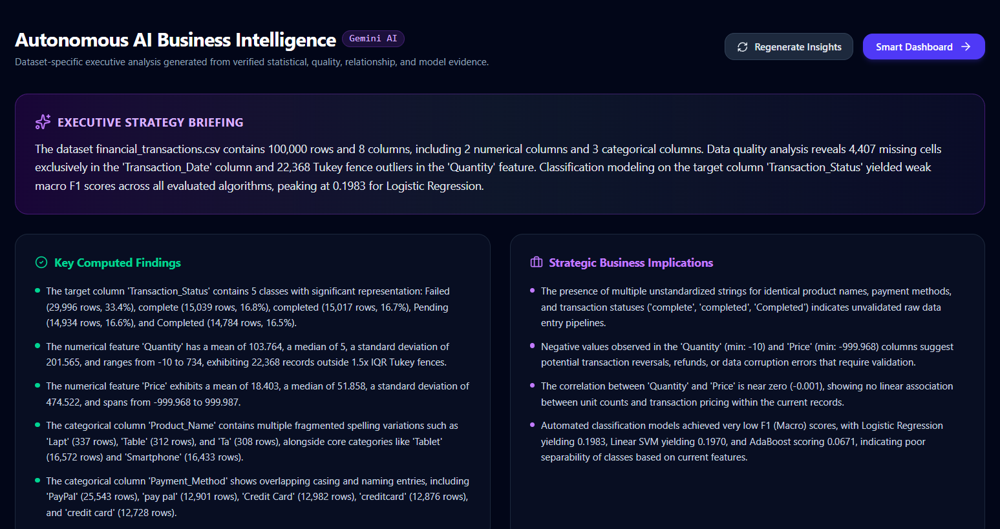

# DataMind AI — Autonomous Data Science Platform

[](https://www.typescriptlang.org/)
[](https://react.dev/)
[](https://fastapi.tiangolo.com/)
[](https://www.python.org/)
[](https://scikit-learn.org/)
[](https://tailwindcss.com/)
[](LICENSE)

> **DataMind AI is a full-stack, AI-powered autonomous data science platform that simplifies the complete data science workflow—from dataset upload and data cleaning to exploratory analysis, automated machine learning, model evaluation, explainability, and AI-assisted insights.**

**Live Demo:** [https://datamind-ai-r7ht.onrender.com](https://datamind-ai-r7ht.onrender.com)

**GitHub Repository:** [DataMind AI — Autonomous Data Scientist](https://github.com/Harini-Nagireddy/DataMind-AI-Autonomous-Data-Scientist)

---

## Table of Contents

- [1. Overview & Motivation](#1-overview--motivation)
- [2. System Architecture](#2-system-architecture)
- [3. End-to-End Workflow](#3-end-to-end-workflow)
- [4. Core Platform Capabilities](#4-core-platform-capabilities)
  - [4.1 Dataset Ingestion & Streaming](#41-dataset-ingestion--streaming)
  - [4.2 Profiling & Automated Target Detection](#42-profiling--automated-target-detection)
  - [4.3 Data Quality Audit & Scoring](#43-data-quality-audit--scoring)
  - [4.4 Configurable Data Cleaning Suite](#44-configurable-data-cleaning-suite)
  - [4.5 Exploratory Data Analysis (EDA)](#45-exploratory-data-analysis-eda)
  - [4.6 AutoML Engine & Adaptive Policy](#46-automl-engine--adaptive-policy)
  - [4.7 Comprehensive Model Evaluation](#47-comprehensive-model-evaluation)
  - [4.8 Model Explainability & Feature Importance](#48-model-explainability--feature-importance)
  - [4.9 Generative AI Insights & Conversational Assistant](#49-generative-ai-insights--conversational-assistant)
  - [4.10 Smart Dashboard & Report Export](#410-smart-dashboard--report-export)
- [5. Technology Stack](#5-technology-stack)
- [6. Project Directory Structure](#6-project-directory-structure)
- [7. Verification & Test Results](#7-verification--test-results)
- [8. Installation & Setup Guide](#8-installation--setup-guide)
  - [8.1 Prerequisites](#81-prerequisites)
  - [8.2 Windows PowerShell Setup](#82-windows-powershell-setup)
  - [8.3 Linux & macOS Setup](#83-linux--macos-setup)
  - [8.4 Environment Configuration](#84-environment-configuration)
  - [8.5 Running the Application](#85-running-the-application)
  - [8.6 Render Cloud Deployment (Single Web Service)](#86-render-cloud-deployment-single-web-service)
- [9. Verified API Endpoints](#9-verified-api-endpoints)
- [10. Visual Presentation & Screenshots](#10-visual-presentation--screenshots)
- [11. Security, Privacy & Reliability](#11-security-privacy--reliability)
- [12. Limitations & Troubleshooting](#12-limitations--troubleshooting)
- [13. Roadmap](#13-roadmap)
- [14. Contributing & License](#14-contributing--license)
- [15. Authors & Contact](#15-authors--contact)

---

## 1. Overview & Motivation

Real-world data science is traditionally fragmented. Practitioners often juggle disconnected Jupyter notebooks for EDA, custom ad-hoc scripts for imputation and outlier removal, separate AutoML frameworks, and manual PowerPoint summaries for stakeholders.

**DataMind AI** bridges this workflow into an integrated, interactive system. Designed as an autonomous end-to-end data science companion, it empowers users to take raw tabular datasets through:
1. Automated profiling, structural validation, and quality assessment.
2. Auditable data cleaning with reproducible before/after tracking.
3. Interactive multi-dimensional exploratory data analysis.
4. Leak-free machine learning model training across classification and regression algorithms.
5. Exhaustive evaluation with cross-validation, confusion matrices, and ROC-AUC curves.
6. Permutation and model-native feature explainability.
7. Executive summaries and conversational analytics powered by Google Gemini, equipped with an offline statistical fallback engine.

---

## 2. System Architecture

DataMind AI is engineered around a decoupled microservice architecture:
- **Client Tier**: A responsive Single Page Application (SPA) built with React 19, TypeScript, Tailwind CSS, and Recharts.
- **Orchestration Tier**: A Node.js + Express backend that provides session-based authentication, manages binary dataset streams to disk, coordinates ML tasks, and interfaces with the Google Gemini API.
- **ML Processing Tier**: A dedicated Python FastAPI microservice that executes compute-heavy data preparation, cross-validation, and model training using scikit-learn, Pandas, and NumPy.



---

## 3. End-to-End Workflow

The platform guides the user through twelve coordinated stages, accessible via the interactive sidebar:


---

## 4. Core Platform Capabilities

### 4.1 Dataset Ingestion & Streaming
- **Supported Formats**: Delimited text files (`.csv`, with auto-detection for semicolon, comma, and tab delimiters) and spreadsheets (`.xlsx`, `.xls`).
- **Dual-Mode Processing**:
  - Files under **25 MB** are parsed in-browser using `PapaParse` and `xlsx` for instant responsiveness.
  - Files between **25 MB and 1 GB** stream directly to server-side temporary storage, bypassing React memory limits.
- **Bounded Interactive Views**: Large files load an active analytical slice of up to 150,000 rows in the browser, while the ML engine accesses the complete underlying dataset on disk.

### 4.2 Profiling & Automated Target Detection
- Profiles every column: data type inference (numeric, categorical, datetime, text, identifier), non-null counts, missing percentages, distinct counts, sample values, and statistical moments (mean, std, min, quartiles, max).
- **Intelligent Target Recommendation**: The Python backend (`/recommend-target`) evaluates target suitability based on uniqueness, cardinality, class balance, and missing ratios, recommending whether the problem represents **binary classification**, **multiclass classification**, or **continuous regression**. Users can override this recommendation at any time.

### 4.3 Data Quality Audit & Scoring
- Computes an aggregate **Data Quality Score (0–100%)** using a multi-factor penalty model:
  - Missingness penalty across rows and columns.
  - Duplicate row penalty.
  - Zero-variance / constant column penalty.
  - High-cardinality identifier penalty.
- Categorizes identified issues into high, medium, and low severity alerts with actionable remediation tips.

### 4.4 Configurable Data Cleaning Suite
Users can apply targeted transformations while preserving the raw source data in state:
- **Deduplication**: Exact duplicate row removal.
- **Numeric Imputation**: Median, Mean, Zero-fill, or Passthrough.
- **Categorical Imputation**: Mode (most frequent), "Missing" tag, or Passthrough.
- **Structural Cleanup**: Drop constant columns, drop identifier-like columns, and trim leading/trailing whitespace.
- **Outlier Mitigation**: Configurable Tukey's IQR rule ($1.5 \times \text{IQR}$) with single-pass bounding.
- **Audit Log**: Every cleaning operation records before/after row and column counts, missing ratios, and execution timestamps.
- **Export**: Instant download of the cleaned dataset as CSV.

### 4.5 Exploratory Data Analysis (EDA)
- **Distribution Analysis**: Interactive histograms and frequency charts with automated binning.
- **Bivariate Correlation**: Computes Pearson correlation coefficients across numeric columns (capped at 30 features to prevent O($N^2$) UI stalls), displayed via an interactive color-coded correlation matrix.
- **Scatter & Group Comparison**: Dynamic scatter plots with trend estimations and category-grouped bar charts.

### 4.6 AutoML Engine & Adaptive Policy
The AutoML engine executes inside `ml_service/main.py`:
1. **Preprocessing Pipeline**: Constructed strictly inside scikit-learn `Pipeline` objects to prevent data leakage from test folds into training folds:
   - *Numeric*: `SimpleImputer(strategy="median")` followed by `StandardScaler()`.
   - *Categorical*: `SimpleImputer(strategy="most_frequent")` followed by `OneHotEncoder(handle_unknown="ignore", sparse_output=True, min_frequency=2, max_categories=100)`.
2. **Train/Test Splitting**: 80/20 train/test holdout split (stratified for classification tasks).
3. **Cross-Validation**: $k$-fold cross-validation on the training set (stratified for classification, standard for regression).
4. **Adaptive Resource Policy**:
   | Dataset Size | Rows Sampled for CV | CV Folds | Permutation Importance |
   |---|---|---|---|
   | $< 100,000$ rows | 100% of rows | 5 folds | Enabled |
   | $100,000 - 500,000$ rows | Up to 80,000 rows | 3 folds | Disabled (native only) |
   | $> 500,000$ rows | Up to 100,000 rows | 3 folds | Disabled (native only) |
5. **Model Catalog**:
   - **Classification**: Logistic Regression, Decision Tree, Random Forest, Extra Trees, AdaBoost, SGD Classifier, Linear SVM; Gaussian Naive Bayes and KNN on compact subsets.
   - **Regression**: Linear Regression, Ridge Regression, Decision Tree, Random Forest, Extra Trees, AdaBoost, SGD Regressor; KNN Regressor on compact subsets.
6. **Model Selection**: Models are ranked by their cross-validated performance on the user's primary metric (default **Macro F1** for classification, **$R^2$** for regression). The top performer is automatically designated the winner and verified on the untouched 20% test set.

### 4.7 Comprehensive Model Evaluation
- **Classification Metrics**: Test Accuracy, Precision (Macro), Recall (Macro), F1 Score (Macro), ROC-AUC (binary), full $N \times N$ Confusion Matrix with true vs. predicted counts, and multi-threshold ROC Curve.
- **Regression Metrics**: $R^2$ Score, Mean Absolute Error (MAE), Mean Squared Error (MSE), Root Mean Squared Error (RMSE), and Mean Absolute Percentage Error (MAPE).
- **Leaderboard Comparison**: Side-by-side training time (ms), cross-validation score ($\mu \pm \sigma$), and baseline comparisons against naive majority-class or mean-target models.

### 4.8 Model Explainability & Feature Importance
- Extracts model-native feature importances (e.g. Gini importance for tree ensembles, absolute coefficients for linear models).
- Calculates permutation feature importance on smaller datasets using held-out test data to measure true out-of-sample impact.
- Visualizes the top 15 most influential predictors with normalized relative percentages.

### 4.9 Generative AI Insights & Conversational Assistant
- **AI Executive Insights**: Sends computed statistical profiles, anomaly reports, correlation summaries, and AutoML metrics to Google Gemini (`gemini-3.5-flash-lite`). Returns structured sections: Executive Summary, Key Findings, Business Implications, Recommended Actions, and Analytical Cautions.
- **AI Data Assistant**: A conversational assistant with full dataset context. Allows users to ask natural-language questions (e.g., *"Which features drove churn the most?"*, *"How did Random Forest compare to Logistic Regression?"*).
- **Dual Reliability & Offline Fallback**:
  - Transient network or rate-limit errors (408, 429, 5xx) trigger exponential backoff retries.
  - If the Gemini API key is missing, invalid, or offline, the platform seamlessly activates an **in-house rule-based statistical fallback engine** that produces verified analytical insights directly from computed numbers without hallucinating.

### 4.10 Smart Dashboard & Report Export
- **Smart Dashboard**: Auto-generates summary metric cards, anomaly summaries, and key distribution charts tailored to the dataset schema.
- **Export Engine**:
  - Single-click **HTML Report** with embedded styling, printable as a publication-ready PDF.
  - Complete **JSON Session Export** preserving the full state, profiling metrics, cleaning log, and AutoML leaderboard.

---

## 5. Technology Stack

| Layer | Technologies | Purpose |
|---|---|---|
| **Frontend Framework** | React 19.0, TypeScript 5.8, Vite 6.2 | Reactive component architecture, type safety, HMR |
| **Styling & Icons** | Tailwind CSS 4.1, Lucide React, Motion | Clean dark-mode UI, responsive layouts, subtle animations |
| **Data Visualization** | Recharts 3.10, HTML5 Canvas | Interactive histograms, scatter plots, confusion matrices, ROC curves |
| **In-Browser File Parsing** | PapaParse 5.7, SheetJS (xlsx) 0.18 | Fast client-side CSV and Excel workbook parsing |
| **Orchestration Backend** | Node.js 18+, Express 4.21, tsx, esbuild | HTTP API gateway, disk stream uploads, process supervisor |
| **Authentication & Security** | Node.js `crypto.scrypt`, HTTP-only cookies | Salted password hashing, secure session management |
| **ML Microservice** | Python 3.10+, FastAPI 0.128, Uvicorn 0.48 | High-performance asynchronous ML API service |
| **Data Science Libraries** | Pandas 2.2+, NumPy 2.2+, scikit-learn 1.8+ | Data sanitization, feature engineering, AutoML pipelines, metrics |
| **Generative AI** | Google Gemini API (`@google/genai` 2.4) | `gemini-3.5-flash-lite` executive insights and conversational Q&A |

---

## 6. Project Directory Structure

```
datamind-ai-autonomous-data-scientist/
├── .env.example              # Environment variable template with safe placeholders
├── .gitignore                # Comprehensive ignore rules (secrets, venv, caches, uploads)
├── auth-store.ts             # Scrypt password hashing & session management
├── CONTRIBUTING.md           # Open-source contribution guidelines
├── index.html                # Application HTML entry point & typography
├── LICENSE                   # MIT License
├── metadata.json             # Application capability descriptors
├── package.json              # Node dependencies, build scripts & metadata
├── package-lock.json         # Pinned npm dependency tree
├── requirements.txt          # Python dependencies (FastAPI, scikit-learn, etc.)
├── server.ts                 # Express server, upload streamer, Gemini router, ML supervisor
├── tsconfig.json             # TypeScript compiler configuration
├── vite.config.ts            # Vite bundler & Tailwind CSS plugin configuration
│
├── docs/
│   └── images/               # Verified UI screenshots & visual asset guide
│       └── README.md         # Screenshot capture checklist & guidelines
│
├── ml_service/
│   └── main.py               # FastAPI microservice: target recommendation & AutoML engine
│
└── src/
    ├── App.tsx               # Main application controller, routing & session state
    ├── index.css             # Tailwind base styles and theme tokens
    ├── main.tsx              # React DOM initialization & global error boundary
    ├── types.ts              # TypeScript domain types & interface contracts
    │
    ├── components/           # UI Components for each workflow stage
    │   ├── AssistantView.tsx     # Conversational AI Data Assistant
    │   ├── AuthPage.tsx          # User signup & login interface
    │   ├── AutoMLView.tsx        # AutoML configuration, progress & leaderboard
    │   ├── DataCleaningView.tsx  # Cleaning operations panel & audit history
    │   ├── DataQualityView.tsx   # Quality score meter & issue diagnostics
    │   ├── DatasetOverview.tsx   # Schema summary, column profiler & sample rows
    │   ├── EDAView.tsx           # Distribution charts & correlation heatmap
    │   ├── EvaluationView.tsx    # Test metrics, confusion matrix & ROC curve
    │   ├── ExplainabilityView.tsx# Feature importance rankings
    │   ├── Header.tsx            # Navigation bar & authentication status
    │   ├── InsightsView.tsx      # Gemini AI executive findings & recommendations
    │   ├── LandingPage.tsx       # Welcome screen with quick actions & samples
    │   ├── ReportView.tsx        # Comprehensive report view & print/PDF exporter
    │   ├── Sidebar.tsx           # Workflow stage navigation sidebar
    │   ├── SmartDashboardView.tsx# Adaptive KPI cards & summary charts
    │   └── UploadSection.tsx     # Drag-and-drop file upload & stream handler
    │
    └── utils/                # Client-side utility functions
        ├── cleaner.ts            # Functional dataset transformation routines
        ├── exportReport.ts       # Standalone HTML report generator & JSON exporter
        ├── parser.ts             # CSV and Excel stream and string parsers
        ├── profiler.ts           # Statistical moments, quality & correlation calculations
        └── sampleData.ts         # Bundled sample benchmark datasets
```

---

## 7. Verification & Test Results

The codebase has undergone local verification:

| Check | Command | Result | Notes |
|---|---|:---:|---|
| **TypeScript Typecheck** | `npm run lint` (`tsc --noEmit`) | **PASS** | `0` type errors across all frontend and backend TypeScript files |
| **Frontend & Server Build** | `npm run build` | **PASS** | Vite production client bundle (`dist/assets/`) and esbuild server bundle (`dist/server.cjs`) built successfully |
| **Python Dependencies & Imports** | `python -c "import fastapi, uvicorn, pandas, numpy, sklearn"` | **PASS** | Verified core packages (`scikit-learn 1.9.1`, `pandas 2.3.3`) load without conflicts |
| **FastAPI Microservice Import** | `python -c "import ml_service.main"` | **PASS** | Microservice compiled cleanly and initialized FastAPI app `v1.2.0` |
| **Dependency Security Audit** | Secret pattern scanner | **PASS** | Zero hardcoded API keys, tokens, or private credentials in tracked source code |

---

## 8. Installation & Setup Guide

### 8.1 Prerequisites
- **Node.js**: `v18.0.0` or higher (verified with Node `v22.x`)
- **Python**: `v3.10` or higher (verified with Python `3.11` / `3.13`)
- **Package Managers**: `npm` (v9+) and `pip`

---

### 8.2 Windows PowerShell Setup

1. **Clone the repository**:
   ```powershell
   git clone https://github.com/<your-username>/datamind-ai-autonomous-data-scientist.git
   Set-Location datamind-ai-autonomous-data-scientist
   ```

2. **Create and activate a Python virtual environment**:
   ```powershell
   python -m venv .venv
   .\.venv\Scripts\Activate.ps1
   ```
   *(If script execution is restricted, run `Set-ExecutionPolicy -Scope Process -ExecutionPolicy Bypass` first).*

3. **Install Python dependencies**:
   ```powershell
   pip install -r requirements.txt
   ```

4. **Install Node.js dependencies**:
   ```powershell
   npm install
   ```

5. **Configure environment variables**:
   ```powershell
   Copy-Item .env.example .env
   ```

---

### 8.3 Linux & macOS Setup

1. **Clone and enter repository**:
   ```bash
   git clone https://github.com/<your-username>/datamind-ai-autonomous-data-scientist.git
   cd datamind-ai-autonomous-data-scientist
   ```

2. **Create and activate virtual environment**:
   ```bash
   python3 -m venv .venv
   source .venv/bin/activate
   ```

3. **Install dependencies**:
   ```bash
   pip install -r requirements.txt
   npm install
   ```

4. **Configure environment variables**:
   ```bash
   cp .env.example .env
   ```

---

### 8.4 Environment Configuration

Open your local `.env` file and configure:

```ini
# Server ports
PORT=3000
ML_PORT=8000

# Path to python in your virtual environment:
# Windows: .\.venv\Scripts\python.exe
# Linux/macOS: .venv/bin/python
PYTHON_EXECUTABLE=python

# Session secret for cookie integrity (min 32 characters)
AUTH_SECRET=a-secure-random-development-secret-key-32-chars

# Google Gemini API key (OPTIONAL)
# If omitted, DataMind AI uses its built-in rule-based statistical fallback engine.
GEMINI_API_KEY="your-gemini-api-key"
GEMINI_MODEL="gemini-3.5-flash-lite"
```

---

### 8.5 Running the Application

Start the unified development server:
```powershell
npm run dev
```

What happens on startup:
1. Node.js Express server starts on `http://localhost:3000`.
2. The server automatically launches the Python FastAPI microservice on `127.0.0.1:8000`.
3. Vite middleware initializes with Hot Module Replacement (HMR).

Open your browser at:
```
http://localhost:3000
```

*(To run production build)*:
```powershell
npm run build
npm start
```

---

### 8.6 Render Cloud Deployment (Single Web Service)

DataMind AI is structured to run as **one unified web service** on [Render](https://render.com). The Node.js Express server acts as the primary reverse proxy and process supervisor, serving the compiled Vite React frontend, handling API routes, and spawning the Python FastAPI ML microservice internally.

#### Automated Blueprint Deployment (Recommended)
1. Fork or push this repository to your GitHub account.
2. Sign in to your [Render Dashboard](https://dashboard.render.com).
3. Click **New +** > **Blueprint**.
4. Select your `DataMind-AI-Autonomous-Data-Scientist` repository.
5. Render detects [`render.yaml`](render.yaml) automatically:
   - **Environment**: Node
   - **Build Command**: `npm ci && pip install -r requirements.txt && npm run build`
   - **Start Command**: `npm start`
   - **Environment Variables**:
     - `NODE_ENV`: `production`
     - `PYTHON_EXECUTABLE`: `python3`
     - `AUTH_SECRET`: *Auto-generated secure random key*
     - `GEMINI_API_KEY`: *Enter your key in the dashboard (optional)*
6. Click **Apply**. Render will install both Python and Node dependencies, compile the production bundles, and boot the application.

#### Manual Web Service Deployment
If creating the service manually on Render:
1. Click **New +** > **Web Service** > select your GitHub repository.
2. Configure settings:
   - **Name**: `datamind-ai`
   - **Region**: Any (e.g. Oregon, Frankfurt)
   - **Branch**: `main`
   - **Runtime**: `Node`
   - **Build Command**: `npm ci && pip install -r requirements.txt && npm run build`
   - **Start Command**: `npm start`
3. Add Environment Variables under **Advanced**:
   - `NODE_ENV` = `production`
   - `PYTHON_EXECUTABLE` = `python3`
   - `AUTH_SECRET` = `<Generate a secure 32+ character random string>`
   - `GEMINI_API_KEY` = `<Your Google Gemini API Key (optional)>`
   - `GEMINI_MODEL` = `gemini-3.5-flash-lite`

#### Ephemeral Storage Considerations
> [!NOTE]
> Render's standard web services use ephemeral container filesystems. This means:
> - Local user accounts registered via the demo auth form (`.datamind-auth/users.json`) and temporary upload streams (`/tmp/datamind-ai-datasets/`) exist inside the active container and reset when the service restarts, redeploys, or sleeps on the free plan.
> - For persistent enterprise production workloads, mount a [Render Persistent Disk](https://render.com/docs/disks) or connect an external managed database (PostgreSQL, Supabase) and cloud object storage (S3, Cloud Storage).


---

## 9. Verified API Endpoints

### Node.js / Express Server (`http://localhost:3000`)

| Method | Endpoint | Protection | Description |
|---|---|:---:|---|
| `POST` | `/api/auth/signup` | Public | Register a new local user account (validates name, email, 8+ character password) |
| `POST` | `/api/auth/login` | Public | Authenticates credentials and issues an HTTP-only `datamind_session` cookie |
| `POST` | `/api/auth/logout` | Public | Clears the session cookie and destroys in-memory session |
| `GET` | `/api/auth/me` | Public | Returns current authenticated user metadata or null |
| `POST` | `/api/datasets/upload` | Session Auth | Streams large CSV/Excel files (up to 1 GB) directly to temporary disk storage |
| `GET` | `/api/datasets/:id/preview` | Session Auth | Streams an analytical preview (up to 150k rows) from a stored dataset |
| `POST` | `/api/ml/recommend-target` | Session Auth | Proxies dataset schema to Python service for target and task classification |
| `POST` | `/api/ml/automl` | Session Auth | Triggers the scikit-learn AutoML training pipeline in the Python service |
| `GET` | `/api/ml/health` | Public | Healthcheck confirming Python FastAPI service status |
| `POST` | `/api/gemini/insights` | Session Auth | Generates executive AI findings via Gemini (with local fallback) |
| `POST` | `/api/gemini/chat` | Session Auth | Conversational Q&A over current dataset analysis and AutoML metrics |

### Python FastAPI Service (`http://127.0.0.1:8000`)

| Method | Endpoint | Description |
|---|---|---|
| `GET` | `/health` | Returns service status and installed scikit-learn version |
| `POST` | `/recommend-target` | Analyzes column profiles, distinct ratios, and target suitability |
| `POST` | `/automl` | Preprocesses data, trains algorithms with CV, computes metrics, and ranks models |

---

## 10. Visual Presentation & Screenshots

Visual previews of DataMind AI across key stages of the data science lifecycle:

| View | Preview |
|---|---|
| **Smart Dashboard** | <br><sub>*Adaptive KPI cards, metric summaries, and automated visualization charts.*</sub> |
| **Data Quality Assessment** | <br><sub>*Data health score meter, missing value breakdowns, duplicate alerts, and column health metrics.*</sub> |
| **AutoML Leaderboard** | <br><sub>*Cross-validated model ranking, training times, primary metric comparisons, and best-model badge.*</sub> |
| **Model Evaluation & ROC** | <br><sub>*Confusion matrices, multi-threshold ROC curves, and classification / regression score cards.*</sub> |
| **Model Explainability** | <br><sub>*Feature importance rankings, relative weight percentages, and baseline model comparisons.*</sub> |
| **Gemini AI Insights** | <br><sub>*Executive summaries, business implications, recommended actions, and conversational Q&A assistant.*</sub> |

> *Note: For instructions on capturing clean screenshots for placement presentations, see the [Screenshot Guidelines](docs/images/README.md).*

---

## 11. Security, Privacy & Reliability

- **Server-Side API Key Isolation**: The Google Gemini API key is loaded only within Node.js `process.env`. It is never delivered to the client browser or bundled in frontend assets.
- **Defensive LLM Orchestration**: All prompts enforce strict analytical grounding on computed data. The assistant is instructed never to fabricate features, models, or metrics.
- **Resilient Offline Fallback**: If network connectivity fails or the Gemini API returns rate limits, the system seamlessly answers from a deterministic local analytical engine.
- **Session Protection**: Passwords are saved with `crypto.scrypt` (64-byte key derivation with random 16-byte salts). Sessions are managed using HTTP-only, `SameSite=Lax` cookies.
- **Resource Limits**: Direct disk streaming prevents server memory exhaustion on large file uploads (1 GB ceiling). Uploaded temporary files are automatically pruned after 2 hours.
- **Tabular Scope**: High-cardinality categorical features are capped to prevent sparse matrix memory blowup.

---

## 12. Limitations & Troubleshooting

### Limitations
- **Tabular Focus**: Optimized for structured tabular data (`.csv`, `.xlsx`, `.xls`). It does not process unstructured computer vision or raw audio data.
- **Demonstration Auth Store**: The current user database resides in a local gitignored file (`.datamind-auth/users.json`). In an enterprise production deployment, this should be replaced with a managed database (PostgreSQL, SQLite, or Redis).
- **AutoML Subsetting on Massive Data**: Datasets with $>100,000$ rows use an adaptive stratified benchmark subset for cross-validation to maintain predictable response times.

### Common Troubleshooting Tips
1. **Python Service Doesn't Start**:
   - Ensure your virtual environment is activated and `uvicorn` is installed (`pip install -r requirements.txt`).
   - If `python` is not in your system PATH, explicitly define `PYTHON_EXECUTABLE=.\.venv\Scripts\python.exe` in `.env`.
2. **Port Conflicts**:
   - By default, Node uses port `3000` and Python uses port `8000`. You can change these in `.env` via `PORT` and `ML_PORT`.
3. **Execution Policy Error on PowerShell**:
   - Run `Set-ExecutionPolicy -Scope Process -ExecutionPolicy Bypass` before activating the virtual environment.

---

## 13. Roadmap

- [x] Automated tabular profiling, quality scoring, and outlier detection.
- [x] Configurable data cleaning suite with audit tracking.
- [x] Python FastAPI scikit-learn AutoML engine with cross-validation.
- [x] Confusion matrix, ROC curve, and feature importance explainability.
- [x] Google Gemini executive insights and conversational Q&A with offline fallback.
- [x] Comprehensive HTML / PDF export.
- [ ] Time-series forecasting algorithms (ARIMA, Prophet).
- [ ] SHAP (SHapley Additive exPlanations) summary beeswarm plots.
- [ ] Integration with cloud databases (PostgreSQL, Snowflake, BigQuery).
- [ ] Model serialization and one-click REST API artifact export (`.joblib` / ONNX).

---

## 14. Contributing & License

Contributions, bug reports, and suggestions are welcome! Please consult [CONTRIBUTING.md](CONTRIBUTING.md) for contribution guidelines.

This project is licensed under the [MIT License](LICENSE).

---

## 15. Authors & Contact

Developed and maintained by **DataMind AI Contributors**.

- **Project Repository**: [datamind-ai-autonomous-data-scientist](https://github.com/Harini-Nagireddy/DataMind-AI-Autonomous-Data-Scientist)
- **Issue Tracker**: [GitHub Issues](https://github.com/Harini-Nagireddy/DataMind-AI-Autonomous-Data-Scientist/issues)

---
*Created for technical interviews, placement evaluation panels, and open-source demonstration.*
